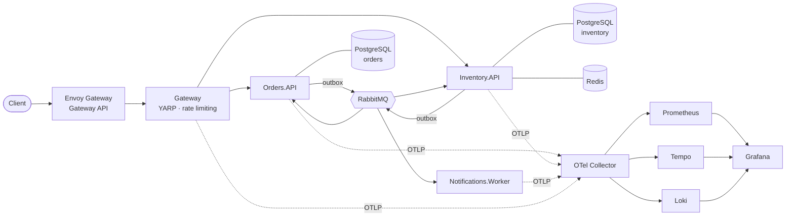
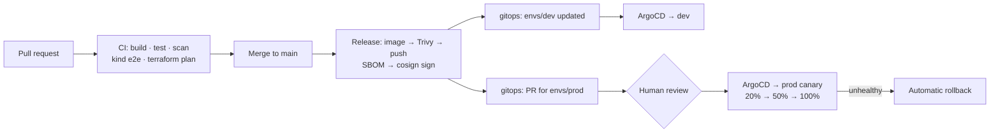

# OrderFlow

[](https://github.com/YasiruHarinda/orderflow/actions/workflows/ci.yml)
[](https://github.com/YasiruHarinda/orderflow/actions/workflows/kubernetes.yml)
[](https://github.com/YasiruHarinda/orderflow/actions/workflows/release.yml)
[](https://github.com/YasiruHarinda/orderflow/actions/workflows/codeql.yml)

**An event-driven order system built as .NET 10 microservices and delivered to Azure Kubernetes Service through a fully automated, GitOps-based platform.**

A customer places an order. Stock is reserved in another service over RabbitMQ, the order is confirmed or rejected, and the customer is notified. All of this keeps working when pods, or the message broker itself, crash halfway through.



## What this project demonstrates

**.NET engineering**
- **Clean Architecture** per service, with layer rules enforced by architecture tests
- **DDD**: aggregates protect their invariants; value objects; domain events
- **CQRS** with a validation decorator (FluentValidation, Scrutor). MediatR is deliberately not used ([ADR-0004](docs/adr/0004-cqrs-without-mediatr.md))
- **Reliable messaging**: MassTransit + RabbitMQ with **transactional outbox and inbox**, retries, dead-letter queues
- **Saga** with compensation and a timeout safety net; idempotent, all-or-nothing stock reservation ([ADR-0003](docs/adr/0003-choreographed-saga-with-timeout.md))
- **EF Core 10** + PostgreSQL: optimistic concurrency (`xmin`), JSON columns, check constraints, migrations run as a Kubernetes Job
- **HybridCache** (memory + Redis) with tag invalidation; **YARP** gateway with rate limiting
- **.NET Aspire** for local development; **OpenTelemetry** with custom business metrics
- **Tests**: unit tests, architecture tests, and **Testcontainers** integration tests against real PostgreSQL and RabbitMQ

**DevOps / platform engineering**
- **CI** (GitHub Actions): build with warnings as errors, migration drift check, unit + integration tests, coverage gate, hadolint, gitleaks, **CodeQL**
- **Supply chain**: chiseled non-root images, **Trivy** gate, **SBOM**, **cosign** keyless signing, every action pinned to a commit SHA, Dependabot
- **Kubernetes**: one hardened **Helm** chart (Pod Security *restricted*, read-only root filesystem, probes, HPA, PDB, NetworkPolicies, graceful shutdown); **Gateway API** with Envoy Gateway
- **End-to-end test on every PR**: the whole system deployed to a throwaway **kind** cluster and real orders placed
- **Terraform**: AKS (Azure CNI Overlay + **Cilium**, workload identity), private PostgreSQL, Key Vault, budget alert. Remote state; **OIDC** login (no cloud secrets in GitHub); plan on PR, approved apply
- **GitOps** with **ArgoCD** (app of apps, separate [gitops repo](https://github.com/YasiruHarinda/orderflow-gitops)): CI deploys to dev, opens a PR for prod
- **Canary releases** with **Argo Rollouts**, automatically rolled back by Prometheus analysis
- **Secrets**: Azure Key Vault → **External Secrets** via workload identity; nothing secret in Git
- **Observability**: OpenTelemetry Collector → Prometheus, Loki, Tempo, Grafana; **SLO burn-rate alerts** with runbooks
- **Reliability**: k6 load test with SLO thresholds; chaos test that kills pods and the broker, then verifies data invariants

## Run it

| Option | Command | Needs |
|---|---|---|
| **Aspire** (fastest; dashboard with traces) | `dotnet run --project src/AppHost` | .NET 10 SDK, Docker |
| **Docker Compose** (real images + Grafana at :3000) | `docker compose up --build` | Docker |
| **Local Kubernetes** (same Helm chart as AKS) | `./scripts/k3d-up.ps1` | Docker, k3d, kubectl, helm |
| **Azure** | see [infra/README.md](infra/README.md) | Azure subscription |

Then open the **web store** at http://localhost:8080 (Compose and k3d; with Aspire, open the `web` link in the dashboard). Add products to the cart, place an order and watch it move from *Placed* to *Confirmed* or *Rejected*; **Stock admin** changes stock levels. The store is a React app in `src/Web`, served by the gateway ([ADR-0013](docs/adr/0013-web-store-served-by-gateway.md)).

Or use the API directly (with Aspire, use the gateway URL shown in the dashboard):
```bash
curl http://localhost:8080/api/v1/products
curl -X POST http://localhost:8080/api/v1/orders -H "Content-Type: application/json" -d '{
  "customerId": "6f1c2d3e-0000-4000-8000-000000000001", "currency": "USD",
  "lines": [{ "sku": "KB-001", "productName": "Mechanical Keyboard", "unitPrice": 89.99, "quantity": 1 }] }'
curl http://localhost:8080/api/v1/orders/<orderId>     # AwaitingStock -> Confirmed
```
Order `LT-001` (no stock) to watch an order get **Rejected**. `scripts/smoke-test.sh` does all of this automatically.

## Delivery pipeline



## Repository layout

```
src/
  Orders/            Domain · Application · Infrastructure · API
  Inventory/         Domain · Application · Infrastructure · API
  Notifications/     Worker (consumes events)
  Gateway/           YARP reverse proxy; also serves the web store
  Web/               React + TypeScript store and stock admin (Vite)
  BuildingBlocks/    shared Domain/Application/Web/Messaging code
  Contracts/         integration events (the public API between services)
  ServiceDefaults/   OpenTelemetry, health checks, resilience
  AppHost/           .NET Aspire local orchestration
tests/               unit · architecture · integration (Testcontainers)
deploy/
  helm/orderflow/    the Helm chart (all environments)
  k8s/               data services and local-cluster manifests
  k6/                load test
infra/terraform/     bootstrap · main · modules (network, aks, keyvault, postgres)
scripts/             k3d-up, smoke test, chaos test
docs/                design, ADRs, runbooks, chaos testing, postmortem template
.github/workflows/   ci · kubernetes · release · infrastructure · codeql
```

- [Chaos testing](docs/chaos-testing.md) · [Postmortem template](docs/postmortems/TEMPLATE.md)

## Known limitations
Honest list, each with a planned fix in the ADRs: no end-user authentication yet ([ADR-0012](docs/adr/0012-authentication-deferred.md)); dev and prod share one cluster ([ADR-0006](docs/adr/0006-single-aks-cluster-namespaces.md)); single-node RabbitMQ; image signatures are produced but not yet enforced at admission ([ADR-0011](docs/adr/0011-ghcr-cosign-supply-chain.md)).
