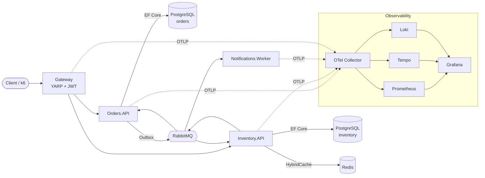
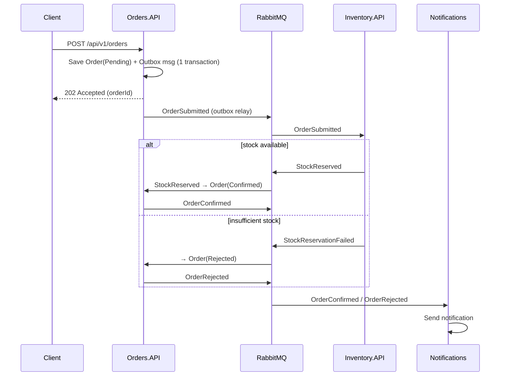

# OrderFlow — Design Document

| | |
|---|---|
| **Status** | v1.0 — implemented |
| **Author** | Yasiru |
| **Date** | 2026-10-14 (draft), 2026-10-16 (implemented) |
| **Target** | .NET 10 (LTS) · Azure Kubernetes Service · GitOps |

> ### Changes made during implementation
> This document was written **before** the code. The decisions below changed while building, and each has an ADR explaining why. Where the text further down disagrees with this table, the table (and the ADR) wins.
>
> | Original design | Implemented | Why |
> |---|---|---|
> | CQRS with MediatR | In-house handler interfaces + Scrutor decorators | MediatR licence change ([ADR-0004](adr/0004-cqrs-without-mediatr.md)) |
> | MassTransit (latest) | MassTransit **v8** | v9 is commercially licensed ([ADR-0002](adr/0002-masstransit-v8-transactional-outbox.md)) |
> | MassTransit state machine saga | Choreographed saga, Order aggregate as the state machine, `StuckOrderMonitor` timeout | No scheduler infrastructure needed ([ADR-0003](adr/0003-choreographed-saga-with-timeout.md)) |
> | JWT auth at the gateway | Deferred; rate limiting and NetworkPolicies only | Scope ([ADR-0012](adr/0012-authentication-deferred.md)) |
> | Prometheus `/metrics` endpoint per service | OTLP → OpenTelemetry Collector → Prometheus remote write | Single telemetry path; exporter still beta ([ADR-0009](adr/0009-opentelemetry-grafana-stack.md)) |
> | ingress-nginx | Gateway API + Envoy Gateway | ingress-nginx retired ([ADR-0010](adr/0010-gateway-api-envoy.md)) |
> | Azure Container Registry | GitHub Container Registry | No standing cost ([ADR-0011](adr/0011-ghcr-cosign-supply-chain.md)) |
> | SonarCloud | CodeQL (C# + workflows), gitleaks, NuGet audit | Native to GitHub, no external account |
> | KEDA scaling on queue depth | CPU-based HPA; queue depth alerted on | Future work |
> | Grafana Tempo/Loki "optional" | Both deployed, with log ↔ trace links | — |
> | — (added) | kind end-to-end deployment test on every PR | Catches chart/image drift before merge |

---

## 1. Summary

OrderFlow is an event-driven order processing system built as .NET 10 microservices and delivered to Azure Kubernetes Service (AKS) through a fully automated, GitOps-based platform.

The project has two equal goals:

1. **Application engineering** — demonstrate production-grade .NET: Clean Architecture, CQRS, reliable messaging (Outbox + Saga), resilience, caching, and thorough automated testing.
2. **Platform engineering** — demonstrate the DevOps lifecycle end to end: containerization, CI with quality and security gates, Infrastructure as Code, Kubernetes, GitOps continuous delivery, progressive rollout, observability, and incident practice.

## 2. Goals and Non-Goals

### Goals
- A customer can place an order; stock is reserved; the customer is notified; the order reaches a final state (`Confirmed` or `Rejected`) even when services fail temporarily.
- Every push to `main` is built, tested, scanned, and deployed to `dev` with no manual steps.
- Production releases are promoted via pull request and rolled out as a canary with automatic rollback on bad metrics.
- Any request can be traced across all services, and every service has a dashboard and alerts.
- The entire cloud environment can be created and destroyed with Terraform in under 20 minutes.
- No secrets are stored in git.

### Non-Goals
- Real payment processing (simulated).
- A frontend UI (OpenAPI/Scalar docs and a k6 script act as clients).
- Multi-region high availability (documented as future work).

## 3. Architecture Overview



### 3.1 Services

| Service | Type | Responsibility | Storage |
|---|---|---|---|
| `Gateway` | ASP.NET Core + YARP | Single entry point, JWT validation, rate limiting, routing | — |
| `Orders.API` | ASP.NET Core Minimal API | Order lifecycle, order saga orchestration | PostgreSQL (`orders` db) |
| `Inventory.API` | ASP.NET Core Minimal API | Products, stock levels, stock reservation | PostgreSQL (`inventory` db), Redis cache |
| `Notifications.Worker` | .NET Worker Service | Consumes events, sends (simulated) email/SMS | — |

Each service owns its data. No service reads another service's database.

### 3.2 Order flow (happy path and failure)



### 3.3 Order saga states

`Submitted → AwaitingStock → Confirmed` or `→ Rejected`. A timeout (configurable, default 2 minutes) moves a stuck order to `Rejected` and publishes a compensating `ReleaseStock`.

## 4. Application Design (.NET)

### 4.1 Solution layout

```
OrderFlow/
├── src/
│   ├── AppHost/                    # .NET Aspire orchestration (local dev)
│   ├── ServiceDefaults/            # Shared OTel, health checks, resilience
│   ├── BuildingBlocks/             # Result type, base entities, messaging contracts
│   ├── Gateway/
│   ├── Orders/
│   │   ├── Orders.Domain/          # Aggregates, value objects, domain events
│   │   ├── Orders.Application/     # CQRS handlers, validators, interfaces
│   │   ├── Orders.Infrastructure/  # EF Core, MassTransit, outbox
│   │   └── Orders.API/             # Minimal API endpoints, composition root
│   ├── Inventory/                  # Same layering as Orders
│   └── Notifications.Worker/
├── tests/
│   ├── Orders.UnitTests/
│   ├── Orders.IntegrationTests/    # Testcontainers: Postgres + RabbitMQ
│   ├── Inventory.UnitTests/
│   ├── Inventory.IntegrationTests/
│   ├── ArchitectureTests/          # NetArchTest layer rules
│   └── Benchmarks/                 # BenchmarkDotNet
├── deploy/
│   ├── docker/                     # docker-compose for non-Aspire runs
│   ├── helm/orderflow/             # Umbrella Helm chart
│   └── k6/                         # Load test scripts
├── infra/terraform/                # Azure infrastructure
├── .github/workflows/              # CI pipelines
└── docs/                           # Design doc, plan, ADRs, runbooks
```

The GitOps desired state lives in a **separate repository**, `orderflow-gitops`, so that application changes and deployment changes have separate history and permissions.

### 4.2 Key technical choices

| Concern | Choice |
|---|---|
| Architecture | Clean Architecture per service; dependencies point inward to `Domain` |
| Domain | DDD aggregates (`Order`, `OrderLine`, `Product`), value objects (`Money`, `Sku`, `Quantity`), domain events |
| Use cases | CQRS with minimal in-house `ICommandHandler`/`IQueryHandler` interfaces (MediatR avoided after its commercial license change); Scrutor for registration; FluentValidation run by a validation decorator |
| Errors | Result pattern internally, mapped to RFC 9457 ProblemDetails at the API edge |
| Persistence | EF Core 10 + Npgsql; migrations applied by a Kubernetes Job, not at app startup |
| Concurrency | Optimistic concurrency (`xmin` row version) on `Product` stock |
| Messaging | MassTransit over RabbitMQ; EF Core transactional outbox + inbox (idempotent consumers) |
| Saga | MassTransit state machine, persisted in PostgreSQL |
| Resilience | `Microsoft.Extensions.Http.Resilience` (retry, circuit breaker, timeout) |
| Caching | `HybridCache` backed by Redis for product reads |
| API | Minimal APIs, API versioning (`/api/v1`), OpenAPI + Scalar UI, built-in rate limiter |
| Auth | JWT bearer at the gateway (Keycloak locally; Entra ID optional) |
| Config | Options pattern with validation on start |
| Logging | Serilog → OTLP; structured, with correlation via trace id |
| Code quality | Nullable enabled, `TreatWarningsAsErrors`, .NET analyzers, Central Package Management, `.editorconfig` |

### 4.3 API surface (v1)

| Method | Route | Service |
|---|---|---|
| `POST` | `/api/v1/orders` | Orders |
| `GET` | `/api/v1/orders/{id}` | Orders |
| `GET` | `/api/v1/orders?customerId=&page=` | Orders |
| `GET` | `/api/v1/products` | Inventory |
| `GET` | `/api/v1/products/{sku}` | Inventory |
| `PUT` | `/api/v1/products/{sku}/stock` | Inventory (admin) |

All services expose `/health/live`, `/health/ready` and Prometheus `/metrics`.

### 4.4 Testing strategy

| Layer | Tooling | What it proves |
|---|---|---|
| Unit | xUnit, FluentAssertions alternative (Shouldly), NSubstitute | Domain rules, handlers, validators |
| Integration | Testcontainers (Postgres, RabbitMQ), `WebApplicationFactory` | Real DB, real broker, outbox delivery, saga transitions |
| Architecture | NetArchTest | Domain has no infrastructure dependencies |
| Load | k6 | Latency SLO and HPA scaling |
| Chaos | Pod deletion during load | Saga still completes every order |

Coverage target: 80% on `Domain` and `Application` layers, enforced in CI.

## 5. Platform Design (DevOps)

### 5.1 Environments

| Env | Where | Deployed by | Purpose |
|---|---|---|---|
| `local` | Laptop, .NET Aspire | `dotnet run` | Development |
| `local-k8s` | Laptop, k3d | Helm | Validate charts before cloud |
| `dev` | AKS, namespace `dev` | ArgoCD, automatic on every `main` build | Integration |
| `prod` | AKS, namespace `prod` | ArgoCD, after promotion PR is merged | "Production" with canary |

To control cost, `dev` and `prod` share one small AKS cluster and are separated by namespace, NetworkPolicies, and resource quotas. Separate clusters are listed as future work in an ADR.

### 5.2 Delivery pipeline

```mermaid
flowchart LR
    PR[Pull Request] --> CI1[Build + Unit tests<br/>+ Integration tests]
    CI1 --> Q[Coverage gate<br/>SonarCloud]
    Q --> M[Merge to main]
    M --> B[Build images<br/>tag = git SHA]
    B --> S[Trivy scan<br/>SBOM + cosign sign]
    S --> P[Push to ACR]
    P --> G1[Bot commits tag to<br/>gitops repo: dev]
    G1 --> A1[ArgoCD syncs dev]
    A1 --> SM[Smoke tests + k6]
    SM --> PRP[Auto-opened promotion PR<br/>for prod]
    PRP --> A2[ArgoCD syncs prod]
    A2 --> C[Argo Rollouts canary<br/>10% → 50% → 100%<br/>metric analysis]
```



**CI (GitHub Actions)**
- `ci.yml` — on PR: restore, build, test, coverage, SonarCloud, Helm lint, Terraform fmt/validate, Dockerfile lint (hadolint).
- `release.yml` — on `main`: build multi-arch images, Trivy scan (fails on HIGH/CRITICAL), generate SBOM (Syft), sign with cosign, push to Azure Container Registry, update `orderflow-gitops` dev values.
- `infra.yml` — on `infra/**` changes: `terraform plan` posted as a PR comment; `apply` on merge with manual environment approval.
- Authentication to Azure uses **OIDC workload identity federation**. No long-lived cloud secrets are stored in GitHub.

**CD (ArgoCD + Argo Rollouts)**
- App-of-apps pattern: one root Application manages platform add-ons and the OrderFlow apps.
- Canary steps with an `AnalysisTemplate` querying Prometheus: rollback if 5xx rate > 1% or p95 latency > 500 ms.

### 5.3 Infrastructure (Terraform)

```
infra/terraform/
├── bootstrap/        # Storage account for remote state (run once)
├── modules/
│   ├── network/      # VNet, subnets
│   ├── aks/          # AKS, node pool, workload identity, OIDC issuer
│   ├── acr/          # Container registry + AKS pull role
│   ├── keyvault/     # Key Vault + access for External Secrets
│   └── postgres/     # Azure Database for PostgreSQL Flexible Server (prod)
└── envs/
    └── main/         # Composition + tfvars
```

- Remote state in Azure Storage with state locking.
- In `dev`, PostgreSQL, Redis and RabbitMQ run in-cluster (Helm charts) to save cost; `prod` uses Azure PostgreSQL Flexible Server (the ADR documents this trade-off).
- Cost guard: one `Standard_B2s`/`B4ms` node pool with autoscaler min 1 / max 3, plus an Azure budget alert. The cluster is destroyed at the end of each working day.

### 5.4 Kubernetes

- One umbrella Helm chart with a sub-chart per service; per-environment values live in the gitops repo.
- Every Deployment: resource requests/limits, liveness/readiness/startup probes, `runAsNonRoot`, read-only root filesystem, dropped capabilities.
- HPA on CPU plus a custom metric (RabbitMQ queue depth via KEDA for `Notifications.Worker`).
- PodDisruptionBudgets, topology spread constraints.
- Default-deny NetworkPolicies with explicit allows.
- ingress-nginx + cert-manager (Let's Encrypt) for TLS.
- External Secrets Operator syncs Azure Key Vault secrets via workload identity.
- Database migrations run as a Helm pre-upgrade hook `Job` (EF Core migration bundle).

### 5.5 Observability

| Signal | Path | Destination |
|---|---|---|
| Traces | OpenTelemetry SDK → OTel Collector | Grafana Tempo |
| Metrics | OTel SDK / `/metrics` → Prometheus | Prometheus (kube-prometheus-stack) |
| Logs | Serilog → OTel Collector | Grafana Loki |

**Dashboards:** golden signals per service (rate, errors, duration, saturation), business dashboard (orders/min, rejection rate, saga duration), RabbitMQ queue depth, Kubernetes resources.

**SLOs:**
- Availability: 99.5% of `POST /orders` return non-5xx (30-day window).
- Latency: p95 `POST /orders` < 300 ms.
- Freshness: 99% of orders reach a final state within 10 s.

**Alerts:** error-budget burn rate (fast and slow), saga stuck > 2 min, queue depth growing for 10 min, pod crash-looping.

### 5.6 Security

- Images: chiseled/distroless .NET base, non-root, Trivy gate, SBOM, cosign signature.
- Supply chain: Dependabot for NuGet, Actions and Docker; pinned Action SHAs.
- Code: SonarCloud, `dotnet list package --vulnerable` in CI.
- Secrets: Key Vault + External Secrets; gitleaks pre-commit and CI scan.
- Cluster: RBAC, NetworkPolicies, Pod Security Standards (`restricted`).

## 6. Reliability and Operations

- **Chaos exercise:** delete Inventory pods and kill the RabbitMQ pod during a k6 run; expected result is that every order still reaches a final state. Findings go into `docs/postmortems/`.
- **Runbooks** (`docs/runbooks/`): saga stuck, high error rate, failed rollout, rotating a secret, restoring the database.
- **DR:** `terraform destroy` + `apply` + ArgoCD sync rebuilds everything; recovery time is measured and recorded.

## 7. Architecture Decision Records

Stored in `docs/adr/` using the Michael Nygard format.

| # | Decision |
|---|---|
| 0001 | Use microservices with database-per-service |
| 0002 | Use MassTransit + RabbitMQ with transactional outbox |
| 0003 | Use .NET Aspire for local development, Helm for Kubernetes |
| 0004 | Use AKS with Terraform |
| 0005 | Use GitOps (ArgoCD) instead of push-based `kubectl` deploys |
| 0006 | Share one cluster with namespace isolation (cost trade-off) |
| 0007 | Use Argo Rollouts for canary with Prometheus analysis |
| 0008 | Use OpenTelemetry + Grafana LGTM stack |

## 8. Risks

| Risk | Mitigation |
|---|---|
| Azure costs exceed credit | Destroy nightly, budget alert, B-series nodes, in-cluster data stores in dev |
| Scope too large for one week | Plan has must-have vs stretch items; cloud is optional until Day 5 |
| Laptop resources (k3d + observability stack) | Lightweight values files, run observability only when needed |
| Tool learning curve (ArgoCD, Terraform) | Validate locally first; each day ends with a working, committed state |

## 9. Future Work

- Separate dev/prod clusters, multi-region failover.
- Policy as code with Kyverno (enforce signed images).
- Feature flags (OpenFeature).
- Ephemeral preview environments per pull request.
